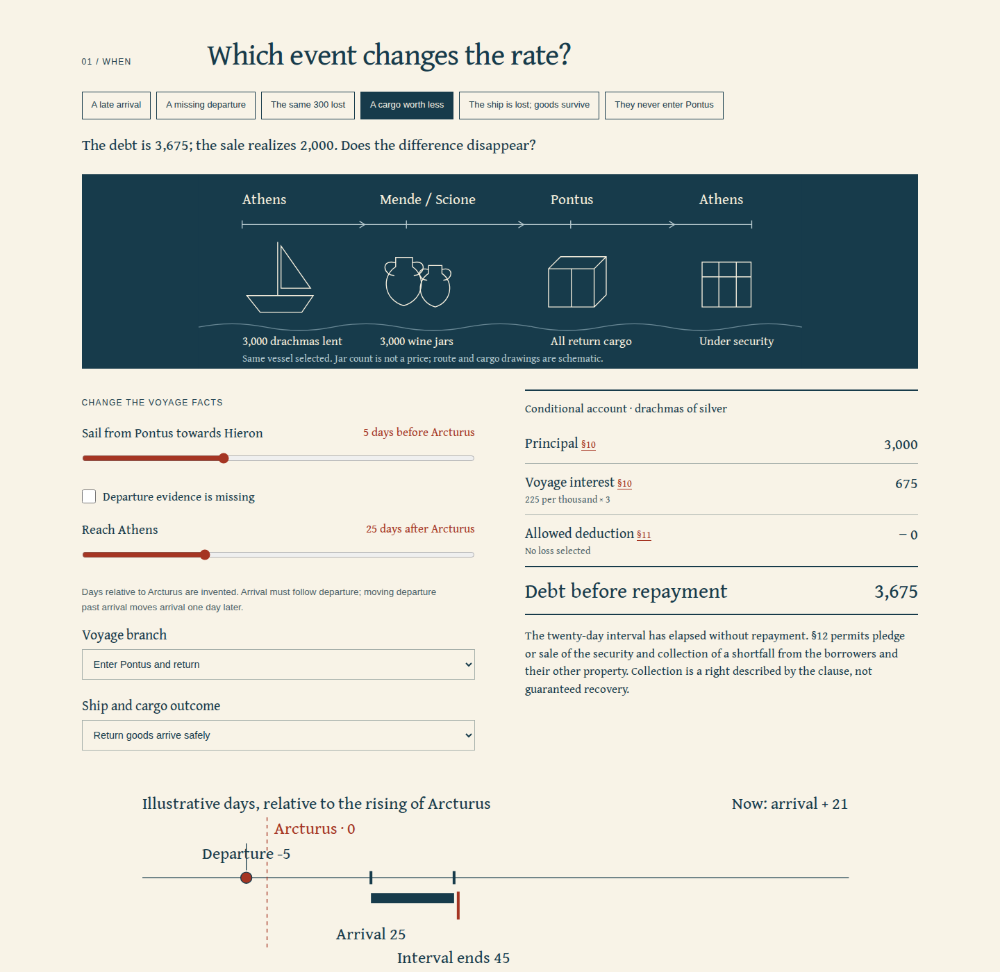

# Nautikon

**A cargo is not a debt. Read an Athenian sea-loan agreement by changing the voyage.**

[](LICENSE)



Arrival after Arcturus does not by itself raise this contract’s interest. The
clause names **departure from Pontus towards Hieron**. A sale of the pledged
cargo for less than the debt does not, in the ordinary default clause, erase the
shortfall. Nautikon lets an English-speaking learner make both distinctions,
change the facts, and read the Greek responsible for the result.

This is a new, **local, unpublished** repository. The intended repository and
Pages addresses in package metadata do not assert a public release. No npm
package is published. [Source and model](docs/source-and-model.md) ·
[Reproducible review](docs/review.md#try-the-actual-work).

## Start here

From this checkout, with Node **24 or later**, Git and npm:

```sh
npm ci
npm run check
npm run dev
```

Open **http://127.0.0.1:4402/nautikon/**. No API key, account, analytics, remote
font service or runtime dependency is needed. Production is:

```sh
npm run build
npm run preview
```

Open **http://127.0.0.1:4401/nautikon/**. Output is **`dist/`**, base
**`/nautikon/`**. Development uses a separate origin and installs no worker.
Stop an existing preview before starting another on the same port.

## Six investigations

| Investigation            | Try                                                                                                               | What to read                                                                            |
| ------------------------ | ----------------------------------------------------------------------------------------------------------------- | --------------------------------------------------------------------------------------- |
| A late arrival           | Keep departure five days before Arcturus. Move arrival to 55 days after it; then move departure to one day after. | §10: 675 interest stays 675 with the first change, becomes 900 with the second.         |
| A missing departure      | Withhold the departure evidence while leaving arrival known.                                                      | The rate and debt remain undetermined.                                                  |
| The same 300 lost        | Change spoilage to jettison; remove the shared decision; try payment to enemies.                                  | §11: the exception includes a condition, not just a loss label.                         |
| A cargo worth less       | Move from day 20 to 21 after safe arrival, with assumed sale proceeds of 2,000.                                   | §12: a 3,675 debt leaves a 1,675 claim after sale, without guaranteeing collection.     |
| Ship lost; goods survive | Select surviving security after irreparable damage to the vessel.                                                 | §13 assigns the survivors jointly to lenders; ordinary debt arithmetic is withheld.     |
| They never enter Pontus  | Select the Hellespont exception.                                                                                  | §13’s conditions and “last year” reference remain visible; this model supplies no rate. |

**Keep this voyage** preserves all its facts before a change. The comparison
includes source conditions, known and missing evidence, deduction, debt, security
and default shortfall. New facts never rewrite the earlier account. A note travels
with both accounts in notebook downloads. The page explicitly does not autosave.

Cargo clauses can be contradicted: another loan on the same goods or a changed
return vessel produces a flag, without inventing a penalty, creditor priority or
court decision. Full modeled repayment releases the security; partial payments
are outside the model.

## Read the agreement

Six readings have exact Greek excerpts, new English and contextual word notes.
Full context **35.9–14** includes the speaker’s introduction and transmitted
testimony. The retained electronic text is Perseus’s Rennie edition, pinned to
commit `70427323b61267cdcd0256b9b02009c23392de07`.

Five full images preserve the title, imprint and printed pp. 107–109 of the
University of Toronto copy at Internet Archive. Visual inspection established
that it is a **1939 reprint of the 1921 edition**. The critical apparatus is
retained. The viewer checks byte count and SHA-256 before displaying a page;
enlargement exposes actual pixels in a keyboard-pannable viewport.

[Provenance](public/sources/provenance.json) · [Reuse notice](public/sources/NOTICE.txt) ·
[Byte inventory](src/asset-manifest.json).

[Saved illustrated reading, gzip](examples/default-reading.html.gz) ·
[Printed reading PDF](examples/default-reading.pdf) · [Reopenable notebook](examples/default-notebook.json).
Decompress the HTML before opening it.

## Keep the work

| Artifact         | Contents                                                                                                                                      |
| ---------------- | --------------------------------------------------------------------------------------------------------------------------------------------- |
| Notebook JSON    | Current voyage, kept voyage and note; strict validation before replacing anything                                                             |
| Ledger CSV       | Both accounts, every selected fact and explicit model scope                                                                                   |
| Timeline SVG     | Star-relative departure, arrival and the twenty-day interval; accessible text description                                                     |
| Illustrated HTML | Both accounts, note, diagrams, all readings and words, full Greek context, five scans, four font subsets, licenses and embedded editable JSON |

The illustrated HTML opens offline without scripts or automatic external
requests. Print it from a browser for a reading PDF. Saving checks the actual
source, font and license bytes; it can be cancelled or retried. Edits during
saving do not change the captured reading. Notes are escaped as text.
**Copy voyage link** includes current voyage facts, with neither notes nor the
kept account. It does not silently replace the page URL.

Production retains a complete edition only after an integrity-checked worker
installation and matching file inventory. Source failures, cache damage and
recovery are observable. Check the footer before going offline. Browser storage
may be evicted; a downloaded reading does not depend on it.

## How the numbers work

The principal stays **3,000 drachmas**, as in §10. The same clause’s **3,000 jars**
are a count of outward security, not its value. The return cargo’s quantity and
commodity are not invented.

For the modeled Pontus voyage, a known departure selects 225 or 300 per thousand.
Interest is `3 × 225 = 675` or `3 × 300 = 900`; it is not annualized or compounded.
The allowed, learner-valued loss is subtracted from principal plus voyage
interest. After safe return and the elapsed repayment interval, assumed sale
proceeds reduce the claim; any positive shortfall remains claimable under §12.
Amounts are bounded whole drachmas, so these accounts use exact integers.

`src/core/model.ts` is pure and independent of the DOM. `readVoyage` and
`readNotebook` reject unknown fields, invalid enums, non-integers, out-of-range
amounts and arrivals preceding departure. Source checks run at build, display
and export boundaries. The build produces the worker from its actual complete
file inventory and hashes.

## Verification and limits

```sh
npm run verify:sources
npm run verify:model
npm run test:browser
npm run test:faults
```

The exact-fraction Python oracle independently checks **576** accounts. Eight
focused tests check the distinctions and import boundaries. Browser review
covers Chromium and Firefox at desktop and 375 px, native downloads, source
navigation, panning, a real unavailable origin, two controlled tabs, cache damage
and repair. [The review](docs/review.md) records the precise results and limits.

This is a **modern selected-clause reading exercise** in the agreement
transmitted in **[Demosthenes], Against Lacritus 35.10–13**. It is a literary
transmission in a partisan forensic speech, not an excavated original contract,
a proven voyage or a verdict. Attribution, document authenticity, judicial
procedure, the real parties’ actions and Athenian law as a whole are not settled
here. Changed voyages, relative days, loss valuations and sale proceeds are
invented. The elapsed-day convention is explicit; it does not reconstruct
Athenian inclusive calendar counting. The Hellespont reference is retained
without treating Murray’s interpretive note as a number supplied by the Greek.

English and lexical explanations have not had independent philological review.
No ancient pronunciation, exchange rate, modern purchasing-power equivalent,
annual investment yield or universal maritime insurance rule is asserted.

## Contributing

Keep the source word, its condition, the numerical assumption and the visible
consequence traceable. See [CONTRIBUTING.md](CONTRIBUTING.md). Proposed historical
claims need a precise source; a test passing does not establish the claim.

## License

Code, new English, diagrams and notes: [MIT](LICENSE), Anthony Mercer.
Perseus text and Greek excerpts: CC BY-SA 4.0. Printed scans are public-domain
material. Gentium Book Plus subsets: SIL Open Font License 1.1.
[Third-party notices](THIRD_PARTY_NOTICES.md).
